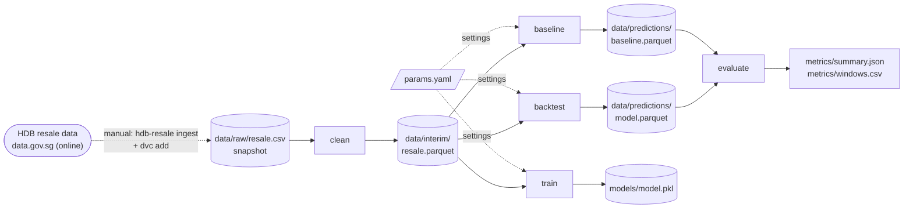

# HDB Resale Price Estimator

**Status:** step 3 (DVC pipeline + MLflow tracking) in progress: the
pipeline is in place, MLflow tracking comes next. The current model, a
hedonic regression with block-level location, is within 3.1% of the resale
price for half of the test sales, and within 8.7% for 9 in 10
([residual analysis](notebooks/04-residuals.ipynb)), against 8.6% and 25.7%
for the reference baseline, the median of recent sales of the same town and
flat type ([baselines](notebooks/02-baselines.ipynb)).

An estimator of fair resale prices for Singapore HDB flats, built as a
production-standard ML project: versioned data, a reproducible pipeline,
experiment tracking, tests, CI with a model-quality gate, a live demo, and
monthly retraining.

> Not affiliated with or endorsed by the Housing & Development Board (HDB)
> or any Singapore government agency. Estimates are statistical, not
> valuations, and not financial advice.

## Brief

### User and decision

A **buyer sanity-checking a specific listing**: "this 4-room in Tampines is
asking S$650k; is that fair?" The buyer enters what the listing says (town,
flat type, storey range, floor area, lease), and gets back an **estimate**
plus a **price range**. Comparing the asking price to that range gives a
**verdict**: fair, high, or low.

That framing drives the choices below: the buyer judges today's listing from
past sales (so validation must respect time), and thinks in "% above fair
value" (so relative error matters as much as dollars).

### Data

[Resale flat prices based on registration date from Jan-2017 onwards](https://data.gov.sg/datasets/d_8b84c4ee58e3cfc0ece0d773c8ca6abc/view),
published by HDB on data.gov.sg. About 242k resale transactions (Jan 2017
onward), refreshed at least monthly, downloadable in full via the public API
with no key required.

- **2017+ only.** Older datasets (1990-2016) have different schemas and,
  before March 2012, a different date basis. They're added only if the
  backtest shows a need.
- **Registration lag.** Transactions appear when registered, weeks after the
  deal. The current month is always incomplete and is excluded from
  training and evaluation.
- **No coordinates.** Location is town, block, and street only. Block-level
  location captures most of what coordinates would add, so geocoding
  (OneMap) is deferred: only 2% of flats are on a block with no recent sale
  ([residual analysis](notebooks/04-residuals.ipynb), section 3).

### Evaluation

The primary metric is the **log-space MAE**, the average of
|log(estimate / resale price)|: it counts every error and treats 10% too
high like 10% too low. It's read through the median and 90th-percentile %
errors ("half within 3%, 9 in 10 within 9%"), with the MAE in S$ alongside.
A model is **good enough** when its log-space MAE is at most half the
reference baseline's and at most 0.05, 9 in 10 estimates fall within 10%,
and its bias stays within ±1% ([ADR-0006](docs/adr/0006-log-mae-and-good-enough-threshold.md)).
Once price ranges exist, their **coverage** (share of real resale prices that
land inside the range) is tracked too.

### Validation

A **rolling backtest**: train on the months before month T, test on month
T+1, then move T forward one month and repeat, over 12 monthly test windows.
How many past months each model trains on is one of its settings, chosen on
a separate **validation period** (the 12 months before the test period):
sliding windows won for every model so far (24 months for the current
model).

```
Window 1:  train [2023-10 ... 2025-09]  test 2025-10
Window 2:  train [2023-11 ... 2025-10]  test 2025-11
...
Window 12: train [2024-09 ... 2026-08]  test 2026-09
```

Repeating gives 12 scores instead of one: their average is more reliable
than a single noisy month, and their spread and trend show whether
performance is stable or drifting. This mirrors production, where the model
is retrained monthly and used on the following month. See
[ADR-0001](docs/adr/0001-rolling-backtest.md).

## Roadmap

| Step | Scope |
|---|---|
| 0 | Framing (this brief, ADRs) |
| 1 | Ingestion + DVC data versioning |
| 2 | Baseline + time-based validation |
| 3 | DVC pipeline + MLflow tracking |
| 4 | Packaging + tests |
| 5 | CI with a model-quality gate |
| 6 | FastAPI + live demo |
| 7 | Monitoring + monthly retraining |

### Decisions deferred, and when they're made

| Decision | Step |
|---|---|
| Primary metric and the "good enough" threshold | 2: decided ([ADR-0006](docs/adr/0006-log-mae-and-good-enough-threshold.md)) |
| Geocoding via OneMap (separate terms and account) | 2: deferred, revisit if new blocks become a larger share |
| MLflow hosting | 3: decided ([ADR-0007](docs/adr/0007-mlflow-local-tracking-s3-artifacts.md)), revisit at 7 |
| Demo name, input granularity, disclaimer wording, final legal check | 6 |
| Keeping the monthly schedule running long term | 7 |

## Decisions

- [ADR-0001](docs/adr/0001-rolling-backtest.md): rolling backtest, not random splits
- [ADR-0002](docs/adr/0002-full-raw-snapshots.md): raw data is a full, immutable snapshot
- [ADR-0003](docs/adr/0003-private-dvc-remote.md): the DVC remote is private
- [ADR-0004](docs/adr/0004-pandas-not-polars.md): pandas, not Polars, with Pandera data contracts
- [ADR-0005](docs/adr/0005-month-levels-carried-forward.md): time as month levels, the latest carried forward
- [ADR-0006](docs/adr/0006-log-mae-and-good-enough-threshold.md): log-space MAE as the primary metric, and the "good enough" threshold
- [ADR-0007](docs/adr/0007-mlflow-local-tracking-s3-artifacts.md): MLflow tracking runs locally, artifacts go to S3

Repo-wide conventions (independent package, shared data bucket) are in the
root [ADR-0001](../../docs/adr/0001-monorepo-conventions.md), and the data
storage setup (S3 in a dedicated workloads account) in root
[ADR-0002](../../docs/adr/0002-s3-in-a-workloads-account.md).

## Getting the data

Run everything from this folder (`projects/01-hdb-resale/`).

**Use the versioned snapshot** (needs access to the private AWS account):

```bash
uv sync                                     # install the project and DVC
aws sso login --profile bjayles-workloads-admin
uv run dvc remote modify --local storage profile bjayles-workloads-admin
uv run dvc pull                             # fetch the snapshot and the trained model from S3
```

The `dvc remote modify --local` line is needed once per clone: it tells DVC
which AWS profile to use, in `.dvc/config.local`, which is not committed.

**Or download a new snapshot** from data.gov.sg (no account needed):

```bash
uv run hdb-resale ingest                    # writes data/raw/resale.csv + snapshot.json
uv run dvc add data/raw/resale.csv          # version it (then commit, and dvc push)
```

Ingestion stays outside the pipeline below: its input is the live API, which
changes every month, so the pipeline starts from the versioned snapshot. A new
snapshot changes its hash, and the next `dvc repro` reruns everything after it.

`data/raw/snapshot.json` records where and when each snapshot came from:
access date, the source's last update, row count, columns, and a sha256
fingerprint of the file.

## Running the pipeline

```bash
uv run dvc repro                            # rerun what changed since the last run
uv run dvc metrics show                     # the latest scores
uv run dvc dag                              # the stages, in the terminal
uv run pytest                               # the tests
```



Solid arrows: data that `dvc repro` passes from stage to stage. Dashed arrows:
the manual download, outside the pipeline, and the settings each stage reads.

| Stage | What it does |
|---|---|
| `clean` | Types and checks the snapshot (rules from the [EDA notebook](notebooks/01-eda.ipynb), Pandera data contracts in `schemas.py`): any missing value, unknown format or changed column stops the pipeline. |
| `baseline` | Backtests the reference baseline (town + flat type median) on the validation and test periods. |
| `backtest` | Backtests the model on the same windows. |
| `evaluate` | Scores both per backtest window and period, and checks the "good enough" threshold on the test period. |
| `train` | Fits the model to ship once, on the latest complete months. |

Settings are chosen on the **validation period** and reported on the **test
period**: every run scores both, so choosing never looks at the test months.

`dvc.yaml` declares each stage's command, the files it reads and writes, and the
settings it uses from `params.yaml` (chosen in notebooks 02–04). `dvc.lock`
records what produced the current outputs (file hashes and settings), and
`dvc repro` reruns only the stages whose inputs changed since, then what
depends on their outputs.

**Where outputs live:** the trained model is pushed to the DVC remote; the other
data outputs are not, since a rerun rebuilds them byte for byte (checked by
their hashes); the metrics are small text files, committed to git so every
change to them shows in a diff.

## Data licence and attribution

Contains information from *Resale flat prices based on registration date
from Jan-2017 onwards* accessed on 2026-10-13 from data.gov.sg (Housing &
Development Board), which is made available under the terms of the
[Singapore Open Data Licence version 1.0](https://data.gov.sg/open-data-licence).

The [first-model notebook](notebooks/03-first-model.ipynb) also contains
information from *HDB Resale Price Index (1Q2009 = 100), Quarterly* accessed
on 2026-10-25 from data.gov.sg (Housing & Development Board), made available
under the same licence, used to check the model's price index.

The access date is updated with each data snapshot. The code is not
licensed for reuse: all rights reserved (see the repo root `LICENSE`). That
notice covers the code, not the data.
